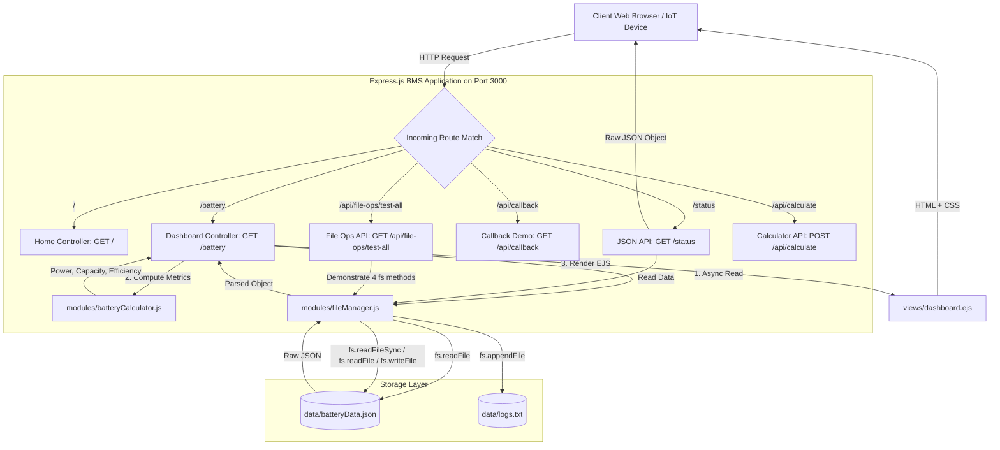

# ⚡ LABORATORY MANUAL: EXPERIMENT 6
## Course: Web Development Laboratory (WPL / CS Lab)
### Title: Battery Management System (BMS) using Node.js, Express.js, EJS, and the File System (`fs`) Module

---

## 1. AIM
To design, implement, and deploy an end-to-end Battery Management System (BMS) web application using Node.js, Express.js, the EJS template engine, and the native File System (`fs`) module to demonstrate HTTP server architectures, RESTful routing, asynchronous callback patterns, file manipulation, and modular backend programming.

---

## 2. OBJECTIVES
1. To understand and construct a native HTTP web server in Node.js using the built-in `http` module.
2. To build an Express.js application featuring structured modular routing (`/`, `/battery`, `/status`, `/about`).
3. To contrast HTML view rendering against dynamic RESTful JSON API generation.
4. To implement the asynchronous error-first callback pattern in Node.js simulating real-time battery sensor data acquisition and health diagnostics.
5. To execute and compare synchronous (`fs.readFileSync`) vs. asynchronous (`fs.readFile`, `fs.writeFile`, `fs.appendFile`) file operations.
6. To design, implement, and import a custom CommonJS module (`batteryCalculator.js`) for computing electrical power, remaining capacity, and energy efficiency.
7. To configure and render multi-page dynamic views using the Embedded JavaScript (EJS) template engine with modular partials (`header`, `navbar`, `footer`).
8. To develop a responsive, modern industrial user interface using custom CSS adhering to a green, black, and white design language.

---

## 3. PROBLEM STATEMENT
Modern energy storage systems—including Electric Vehicles (EVs), renewable solar storage units, and industrial uninterrupted power supplies (UPS)—rely heavily on Battery Management Systems (BMS) to preserve battery longevity, prevent thermal runaway, and ensure high operating efficiency. 

Web-connected BMS telemetry requires:
- A high-concurrency, non-blocking backend server capable of acquiring sensor data from persistent storage or data streams.
- The ability to log operational events without blocking the main event thread.
- A user-friendly, responsive real-time dashboard displaying key indicators: Pack Voltage ($V$), Pack Current ($I$), Cell Voltages, Pack Temperature ($T$), State of Charge ($SoC\%$), State of Health ($SoH$), and Instantaneous Electrical Power ($P = V \times I$).
- An API endpoint serving machine-readable telemetry JSON to external clients and IoT gateways.

This experiment solves this challenge by developing a full-stack Node.js and Express.js solution that fulfills all industrial telemetry requirements and pedagogical web programming benchmarks.

---

## 4. APPARATUS / SOFTWARE USED
| Component | Specification / Version | Purpose |
|:---|:---|:---|
| **Operating System** | Windows 10/11, Linux, or macOS | Development environment |
| **Runtime Environment** | Node.js (v16.x to v24.x) | Asynchronous V8 JavaScript runtime |
| **Package Manager** | npm (Node Package Manager v8.x to v11.x) | Dependency management |
| **Framework** | Express.js (^4.21.2) | Web application routing and middleware framework |
| **Template Engine** | EJS (^3.1.10) | Server-side HTML template rendering |
| **Core Node Modules** | `http`, `fs`, `path` | Native runtime modules for networking and disk I/O |
| **Web Browser** | Google Chrome / Microsoft Edge | Client-side testing and rendering |
| **Code Editor** | VS Code / Antigravity IDE | Source code authoring and debugging |

---

## 5. THEORY

### 5.1 Node.js Architecture and the Single-Threaded Event Loop
Node.js is an open-source, cross-platform runtime environment built on Google Chrome's V8 JavaScript engine. Unlike traditional multi-threaded web servers (such as Apache) that allocate a dedicated thread per connection, Node.js operates on a single-threaded **Event Loop** utilizing non-blocking, asynchronous I/O via **libuv**. When an I/O operation (e.g., disk read or database query) is requested, Node delegates the work to a background worker thread in the libuv thread pool and continues executing other tasks. Once the I/O operation completes, the callback or promise resolution is placed in the event queue and processed by the Event Loop.

### 5.2 Native HTTP Module vs. Express.js
- **Native `http` Module**: Built into the Node.js standard library. It requires manual parsing of request URLs, HTTP headers, query parameters, body streams, and MIME types. Useful for lightweight tasks and fundamental learning.
- **Express.js**: A minimal, flexible web application framework built on top of the native `http` module. It abstracts routing, request/response lifecycle management, middleware integration (`app.use()`), and static file serving (`express.static()`).

### 5.3 Asynchronous Programming and the Error-First Callback Pattern
In Node.js, asynchronous functions accept a callback function as their final argument. Conventionally, callbacks follow the **error-first convention**:
```javascript
function callback(err, data) {
  if (err) {
    // Handle error condition
    return console.error(err);
  }
  // Process successful result
  console.log(data);
}
```
This ensures that errors are explicitly checked before data manipulation occurs.

### 5.4 Synchronous vs. Asynchronous File System Operations (`fs` Module)
Node.js provides the native `fs` module to interact with the local filesystem:
1. `fs.readFileSync(path, encoding)`: **Synchronous**. Halts the execution of the entire Node.js process until the file is fully loaded into memory. Used primarily during startup configuration.
2. `fs.readFile(path, encoding, callback)`: **Asynchronous**. Non-blocking read operation that executes a callback upon completion without blocking other incoming HTTP connections.
3. `fs.writeFile(path, data, encoding, callback)`: **Asynchronous**. Writes data to a specified file, replacing the file if it already exists.
4. `fs.appendFile(path, data, encoding, callback)`: **Asynchronous**. Appends data to the end of a specified file. If the file does not exist, it is created automatically. Ideal for server logs and telemetry logging.

### 5.5 CommonJS Module System
Node.js utilizes the **CommonJS (CJS)** module specification:
- Variables, functions, and objects defined in a file remain private to that file unless explicitly assigned to `module.exports` or `exports`.
- Other files consume these exported elements using the `require('path')` function.

### 5.6 Embedded JavaScript (EJS) Templating Engine
EJS allows developers to dynamically generate HTML markup with vanilla JavaScript:
- `<%= variable %>`: HTML-escapes and outputs the evaluated JavaScript expression.
- `<%- include('path') %>`: Injects raw HTML / partial templates without escaping.
- `<% code %>`: Executes control-flow statements (loops, conditionals) without printing output.

---

## 6. ALGORITHM

### 6.1 Server Startup and Initialization
1. Initialize the Express application instance (`const app = express()`).
2. Register view engine as `ejs` and set the views directory path.
3. Mount `express.static('public')` to serve stylesheets, client scripts, and image assets.
4. Mount body parsers: `express.urlencoded()` and `express.json()`.
5. Register application routes defined in `routes/batteryRoutes.js`.
6. Register fallback 404 and 500 error-handling middlewares.
7. Invoke `app.listen(3000)` to bind the server to the configured network port.
8. On server startup:
   - Invoke `batteryCalculator` custom module functions with initial telemetry to verify calculations.
   - Trigger `checkBatteryHealthWithCallback()` to execute and log the asynchronous callback diagnostic flow.

### 6.2 Telemetry Ingestion and Dashboard Rendering (`GET /battery`)
1. Client issues a `GET /battery` request.
2. The route handler calls `fileManager.readBatteryDataAsync()`.
3. `fs.readFile()` reads `data/batteryData.json` asynchronously from disk.
4. If an error occurs:
   - Return HTTP 500 status and render `views/dashboard.ejs` with an error alert.
5. If successful:
   - Parse raw JSON string into a JavaScript Object.
   - Invoke `batteryCalculator.calculatePower(voltage, current)` to compute instantaneous power.
   - Invoke `batteryCalculator.calculateRemainingCapacity(nominalCapacity, chargePercentage)` to compute usable Ah.
   - Invoke `batteryCalculator.calculateEfficiency(inputPower, outputPower)` to compute charging efficiency.
   - Render `views/dashboard.ejs` passing the battery data and computed metrics.
6. The client browser parses HTML/CSS and renders the glowing telemetry dashboard.

### 6.3 Callback Demonstration Execution Flow (`checkBatteryHealthWithCallback`)
1. Receive request or function invocation.
2. Print and record message: `"Checking Battery..."`.
3. Initiate asynchronous file read via `readBatteryDataAsync()`.
4. Upon successful load, print and record: `"Battery Data Loaded..."`.
5. Execute callback function: `"Callback Executed"`.
6. Inspect operational thresholds:
   - If `temperature > 50` or `voltage < 42`: Health = `"Critical Attention Needed"`.
   - If `temperature > 40` or `voltage < 45`: Health = `"Fair / Warning"`.
   - Else: Health = `"Good"`.
7. Print and record: `"Battery Health: Good"`.
8. Return final diagnostic payload to caller.

---

## 7. SYSTEM FLOWCHARTS

### 7.1 Request & Architecture Flowchart (Mermaid)



### 7.2 Callback Diagnostic Execution Sequence (ASCII Diagram)

```
[Trigger Request] ───> checkBatteryHealthWithCallback(onHealthEvaluated)
                               │
                               ├──> 1. Log: "Checking Battery..."
                               │
                               ├──> 2. Call: readBatteryDataAsync()
                               │          │ (libuv thread pool reads batteryData.json)
                               │          ▼
                               ├──> 3. Log: "Battery Data Loaded..."
                               │
                               ├──> 4. Log: "Callback Executed"
                               │
                               ├──> 5. Diagnostic Evaluation: Check Temperature & Voltage
                               │
                               ├──> 6. Log: "Battery Health: Good"
                               │
                               └──> 7. Return Result Object to Caller / UI
```

---

## 8. STEP-BY-STEP PROCEDURE

### Step 1: Project Initialization
1. Create a root working directory named `nodejsexp6`.
2. Open PowerShell / Command Prompt and initialize a Node.js project:
   ```bash
   npm init -y
   ```
3. Configure `package.json` with project scripts (`start`, `start:http`) and metadata.

### Step 2: Dependency Installation
1. Install Express.js and the EJS template engine:
   ```bash
   npm install express ejs
   ```
2. Verify that `node_modules/` and `package-lock.json` are created.

### Step 3: Implement Experiment 1 (Native HTTP Server)
1. Create `server-http.js`.
2. Import the built-in `http` module (`const http = require('http')`).
3. Call `http.createServer()` and set HTTP status 200 with headers `'Content-Type': 'text/html'`.
4. Output the required message: `"Battery Management System Server Running"`.
5. Listen on port 3001.

### Step 4: Implement Experiment 5 (Custom Calculator Module)
1. Create directory `modules/` and file `modules/batteryCalculator.js`.
2. Implement:
   - `calculatePower(voltage, current)` $\rightarrow P = V \times I$
   - `calculateRemainingCapacity(capacity, chargePercentage)` $\rightarrow Cap \times \frac{SoC}{100}$
   - `calculateEfficiency(inputPower, outputPower)` $\rightarrow \left(\frac{P_{out}}{P_{in}}\right) \times 100$
3. Export using `module.exports = { calculatePower, calculateRemainingCapacity, calculateEfficiency }`.

### Step 5: Implement Experiments 3 & 4 (File System & Callback Module)
1. Create `data/batteryData.json` with realistic 16S LiFePO4 battery pack parameters.
2. Create `modules/fileManager.js` and import `fs` and `path`.
3. Implement `readBatteryDataSync()` utilizing `fs.readFileSync()`.
4. Implement `readBatteryDataAsync()` utilizing `fs.readFile()` with error-first callback.
5. Implement `writeBatteryData()` utilizing `fs.writeFile()`.
6. Implement `appendBmsLog()` utilizing `fs.appendFile()` writing to `data/logs.txt`.
7. Implement `checkBatteryHealthWithCallback()` to execute the 4-step diagnostic callback flow.

### Step 6: Implement Experiment 2, 6, & 7 (Routes & Express Application)
1. Create `routes/batteryRoutes.js` and define routes for:
   - `GET /` (Renders `index.ejs`)
   - `GET /battery` (Renders `dashboard.ejs`)
   - `GET /status` (Returns telemetry JSON)
   - `GET /about` (Renders `about.ejs`)
   - `GET /api/callback` (Returns callback trace)
   - `GET /api/file-ops/test-all` (Tests all 4 `fs` methods)
   - `POST /api/calculate` (Executes calculator calculations)
2. Create `app.js` configuring EJS, `express.static('public')`, body-parser middleware, error-handling middleware, and server listener on port 3000.

### Step 7: Create Views and Modern Stylesheet
1. Create `views/partials/header.ejs`, `navbar.ejs`, and `footer.ejs`.
2. Create `views/index.ejs`, `views/dashboard.ejs`, and `views/about.ejs`.
3. Create `public/css/style.css` with a green, black, and white theme, glowing indicators, responsive grid cards, and terminal logs.
4. Create `public/js/main.js` to enable interactive callback testing, file operations verification, and live recalculations without page reload.

### Step 8: Execution and Verification
1. Run `npm start` to test the full Express application on [http://localhost:3000](http://localhost:3000).
2. Test `/status` JSON response.
3. Test interactive buttons on the dashboard for callbacks and file operations.
4. Run `npm run start:http` to verify Experiment 1 on [http://localhost:3001](http://localhost:3001).

---

## 9. CODE EXPLANATION

### 9.1 `server-http.js` (Experiment 1: Native HTTP Server)
```javascript
const http = require('http');
const PORT = process.env.HTTP_PORT || 3001;

const server = http.createServer((req, res) => {
  res.writeHead(200, { 'Content-Type': 'text/html; charset=utf-8' });
  res.end('<h1>Battery Management System Server Running</h1>');
});

server.listen(PORT, () => {
  console.log(`Native HTTP Server running on http://localhost:${PORT}`);
});
```
- **Line 1**: Loads Node's built-in `http` module.
- **Line 4**: `http.createServer()` creates a low-level HTTP server that triggers an event whenever an HTTP request hits the assigned port.
- **Line 5**: `res.writeHead(200, ...)` writes the HTTP 200 OK status and MIME header.
- **Line 6**: `res.end()` outputs the HTML response body and closes the connection stream.

### 9.2 `modules/batteryCalculator.js` (Experiment 5: Custom Module)
```javascript
function calculatePower(voltage, current) {
  const v = parseFloat(voltage) || 0;
  const i = parseFloat(current) || 0;
  return parseFloat((v * i).toFixed(2));
}

function calculateRemainingCapacity(capacity, chargePercentage) {
  const cap = parseFloat(capacity) || 0;
  const soc = Math.min(Math.max(parseFloat(chargePercentage) || 0, 0), 100);
  return parseFloat((cap * (soc / 100)).toFixed(2));
}

function calculateEfficiency(inputPower, outputPower) {
  const pIn = parseFloat(inputPower) || 0;
  const pOut = parseFloat(outputPower) || 0;
  if (pIn <= 0) return 0;
  return parseFloat(Math.min((pOut / pIn) * 100, 100).toFixed(2));
}

module.exports = { calculatePower, calculateRemainingCapacity, calculateEfficiency };
```
- Functions sanitize user inputs with `parseFloat()` and fallback to `0`.
- Mathematical formulas calculate electrical power ($P = V \times I$), remaining battery capacity, and charging efficiency percentage.
- `module.exports` exposes these three functions to any file using `require()`.

### 9.3 `modules/fileManager.js` (Experiments 3 & 4: File Operations & Callback)
- **`fs.readFileSync(DATA_FILE, 'utf-8')`**: Synchronously reads the JSON file, halting thread execution until completion.
- **`fs.readFile(DATA_FILE, 'utf-8', (err, data) => { ... })`**: Non-blocking asynchronous read accepting an error-first callback.
- **`fs.writeFile(DATA_FILE, jsonString, (err) => { ... })`**: Overwrites battery data with updated metrics.
- **`fs.appendFile(LOG_FILE, entry, (err) => { ... })`**: Appends timestamped events to `data/logs.txt`.
- **`checkBatteryHealthWithCallback(callback)`**: Implements the required 4-step sequence:
  1. `console.log('Checking Battery...')`
  2. Read data asynchronously
  3. `console.log('Battery Data Loaded...')`
  4. `console.log('Callback Executed')`
  5. `console.log('Battery Health: Good')`

### 9.4 `routes/batteryRoutes.js` (Experiment 2: Routing & JSON Status)
- `router.get('/status', (req, res) => { ... })`:
  Reads `batteryData.json` asynchronously and responds with `res.status(200).json({ batteryId, voltage, current, temperature, chargePercentage, batteryHealth })`.
- `router.get('/battery', (req, res) => { ... })`:
  Computes metrics using `batteryCalculator` and renders `views/dashboard.ejs`.

### 9.5 `app.js` (Experiments 6 & 7: Express Application Core)
- `app.set('view engine', 'ejs')`: Registers the EJS template compiler.
- `app.use(express.static(path.join(__dirname, 'public')))`: Automatically serves files from `public/` (CSS, client JS, images).
- `app.use('/', batteryRoutes)`: Mounts all modular routes.
- Handles 404 and 500 error scenarios gracefully.

---

## 10. EXPECTED OUTPUTS

### 10.1 Terminal Console Output (`npm start`)
```
===============================================================
⚡ BATTERY MANAGEMENT SYSTEM (BMS) - LAB EXPERIMENT 6
===============================================================
🚀 Server listening on: http://localhost:3000
📊 Battery Dashboard:  http://localhost:3000/battery
🔌 Status API (JSON):  http://localhost:3000/status
ℹ️  About Page:         http://localhost:3000/about
---------------------------------------------------------------

[EXPERIMENT 5: Custom Module Demonstration]
  > Power (51.84V * 14.50A):              751.68 W
  > Remaining Capacity (100Ah @ 84% SoC): 84 Ah
  > Efficiency (Pin=800W, Pout=751.68W): 93.96%

[EXPERIMENT 3: Callback Pattern Demonstration]
Checking Battery...
[fs.readFile] Successfully read batteryData.json asynchronously.
Battery Data Loaded...
Callback Executed
Battery Health: Good
  > Callback Result -> Health: Good, Charge: 84%, Temp: 29.4°C
===============================================================
```

### 10.2 JSON Output from `GET /status`
```json
{
  "batteryId": "BMS-EV-7048",
  "voltage": 51.84,
  "current": 14.5,
  "temperature": 29.4,
  "chargePercentage": 84,
  "batteryHealth": "Good",
  "calculatedPowerWatts": 751.68,
  "chargingStatus": "Discharging",
  "lastUpdated": "2026-10-22T18:10:00.000Z"
}
```

### 10.3 JSON Output from `GET /api/file-ops/test-all`
```json
{
  "success": true,
  "summary": "All 4 file system operations demonstrated successfully",
  "operations": {
    "readFileSync": {
      "success": true,
      "message": "Synchronous read completed via fs.readFileSync()",
      "voltage": 51.84
    },
    "readFile": {
      "success": true,
      "message": "Asynchronous read completed via fs.readFile()",
      "batteryId": "BMS-EV-7048"
    },
    "appendFile": {
      "success": true,
      "message": "Log appended successfully via fs.appendFile()",
      "entry": "[2026-10-22T18:23:26.685Z] Automated Test: Telemetry verified by fs.appendFile()"
    },
    "writeFile": {
      "success": true,
      "message": "Data successfully updated via fs.writeFile()"
    }
  }
}
```

### 10.4 Browser Output on Native Server (`http://localhost:3001/`)
Displays:
> **Battery Management System Server Running**  
> Server Status: ONLINE | Port: 3001 | Protocol: HTTP/1.1

---

## 11. VIVA VOCE QUESTIONS AND ANSWERS (25 DETAILED Q&As)

### Q1. What is Node.js, and how does it differ from traditional browser-based JavaScript?
**Answer**: Node.js is an open-source, cross-platform runtime environment that allows developers to run JavaScript code outside of a web browser on the server side. It is powered by Google's V8 JavaScript engine. While browser JavaScript interacts with the Document Object Model (DOM) and the window object, Node.js provides server-side APIs for networking (`http`), file system manipulation (`fs`), process control (`process`), and cryptography (`crypto`).

### Q2. Explain the Event Loop in Node.js.
**Answer**: The Event Loop is the mechanism that allows Node.js to perform non-blocking I/O operations despite JavaScript being single-threaded. It constantly checks if the call stack is empty. If empty, it dequeues tasks from task queues (timers, I/O callbacks, check/setImmediate, close callbacks) and pushes them onto the call stack for execution.

### Q3. What is the difference between synchronous and asynchronous code in Node.js?
**Answer**: Synchronous code executes sequentially; each statement blocks the single thread until it completes. In contrast, asynchronous code initiates an operation (such as reading a file or sending a network request) and immediately returns execution to the next line. When the operation completes, its callback or promise handler is scheduled on the event loop without blocking execution.

### Q4. Differentiate between `fs.readFileSync()` and `fs.readFile()`.
**Answer**: `fs.readFileSync()` is synchronous and blocking. It halts the entire Node.js server thread until the file is fully read into memory, preventing other requests from being handled during this time. `fs.readFile()` is asynchronous and non-blocking; it delegates file reading to libuv worker threads and invokes a callback function once reading finishes, allowing the server to handle concurrent user traffic.

### Q5. What is an error-first callback? Why is it standard in Node.js?
**Answer**: An error-first callback is a convention where the first argument of the callback function is reserved for an error object, and subsequent arguments contain the successful result (`callback(err, result)`). It is standard because it guarantees that developers explicitly verify whether an operation failed (`if (err)`) before attempting to process the data, avoiding silent unhandled failures.

### Q6. What is Express.js, and why is it preferred over Node's native `http` module?
**Answer**: Express.js is a lightweight web framework built on top of the native `http` module. While the native `http` module requires manually parsing URLs, querystrings, HTTP methods, headers, and request bodies, Express simplifies development by providing intuitive routing (`app.get()`, `app.post()`), modular routers, middleware support, static asset serving, and template engine integration.

### Q7. What is middleware in Express.js?
**Answer**: Middleware functions are functions that have access to the request object (`req`), response object (`res`), and the `next` function in the application’s request-response cycle. They can execute code, modify `req` and `res`, end the request-response cycle, or call `next()` to pass control to the subsequent middleware. Examples include `express.json()`, `express.static()`, and authentication guards.

### Q8. What does `express.static()` do?
**Answer**: `express.static()` is a built-in middleware function in Express that serves static assets (such as CSS stylesheets, client-side JavaScript scripts, fonts, and images) directly from a specified directory (e.g., `app.use(express.static('public'))`).

### Q9. What is EJS, and how does it work?
**Answer**: EJS (Embedded JavaScript) is a server-side template engine for Node.js. It allows embedding raw JavaScript logic inside HTML templates. When a client requests a page, the Express server renders the EJS template on the server, interpolates variables and executes loops/conditionals, and transmits the resulting static HTML string to the browser.

### Q10. What is the difference between `<%= %>`, `<%- %>`, and `<% %>` in EJS?
**Answer**:
- `<%= expression %>`: Evaluates the expression, HTML-escapes special characters (to prevent Cross-Site Scripting), and prints the result.
- `<%- expression %>`: Evaluates and prints raw unescaped HTML into the template (used for including partials `<%- include('navbar') %>`).
- `<% code %>`: Executes JavaScript control-flow logic (like `if` conditions or `forEach` loops) without printing any output to the rendered page.

### Q11. What is the difference between `fs.writeFile()` and `fs.appendFile()`?
**Answer**: `fs.writeFile()` writes data to a file by overwriting any existing contents (or creating the file if it does not exist). `fs.appendFile()` adds the specified data to the end of the existing file without modifying or deleting preexisting content, making it ideal for event logs.

### Q12. How does Node.js handle modularity using CommonJS?
**Answer**: In CommonJS, every file is treated as a separate module with its own scope. Variables and functions are private by default. A module shares its functionality by attaching properties to `module.exports` or `exports`. Another file imports the module using `const myModule = require('./myModule')`.

### Q13. In a Battery Management System (BMS), what is State of Charge (SoC)?
**Answer**: State of Charge (SoC) represents the available battery capacity expressed as a percentage of its rated capacity (from 0% to 100%). It is analogous to a fuel gauge in a conventional vehicle.

### Q14. In a BMS, what is State of Health (SoH)?
**Answer**: State of Health (SoH) is a figure of merit that reflects the general condition of a battery and its ability to deliver specified performance compared to a fresh battery. It accounts for capacity degradation, internal resistance increase, and cycling wear.

### Q15. Why is monitoring individual cell voltages critical in a multi-cell battery pack?
**Answer**: In series-connected packs (e.g., 16S packs), all cells carry the same current, but individual cells may vary in capacity or internal resistance due to manufacturing variations or temperature gradients. Monitoring individual cells enables active cell balancing and prevents single-cell over-charging or under-voltage damage, which can cause thermal runaway or premature failure.

### Q16. How is instantaneous power calculated in this BMS project?
**Answer**: Power is calculated using Ohm's Law and electrical power formula:
$$P = V \times I$$
Where $P$ is power in Watts (W), $V$ is pack voltage in Volts (V), and $I$ is pack current in Amperes (A). This is implemented in `modules/batteryCalculator.js` via the `calculatePower()` function.

### Q17. How is remaining capacity calculated in this BMS project?
**Answer**: Remaining usable capacity is calculated as:
$$\text{Remaining Capacity (Ah)} = \text{Nominal Capacity (Ah)} \times \left(\frac{\text{SoC}}{100}\right)$$
This is computed by `calculateRemainingCapacity()` in the custom module.

### Q18. What is `package.json` in a Node.js project?
**Answer**: `package.json` is the manifest file of a Node.js application. It records project metadata (name, version, author, license), operational scripts (e.g., `npm start`), and the external dependencies (`dependencies` and `devDependencies`) required by the application.

### Q19. What is the role of `package-lock.json`?
**Answer**: `package-lock.json` is automatically generated by npm to record the exact versions of dependencies and sub-dependencies installed in `node_modules`. It guarantees reproducible builds across different machines and team members.

### Q20. How does Express differentiate between HTML and JSON responses?
**Answer**: Express inspects the response method used:
- `res.render('viewName', data)`: Compiles the template, sets `'Content-Type': 'text/html'`, and returns HTML.
- `res.json(object)`: Serializes the JavaScript object into a JSON string, sets `'Content-Type': 'application/json'`, and returns machine-readable JSON.

### Q21. What happens if you do not call `next()` in an Express middleware function?
**Answer**: If a middleware function does not send a response (e.g., `res.send()` or `res.end()`) and does not invoke `next()`, the request is left hanging, and the client will eventually experience a connection timeout.

### Q22. How are 404 (Not Found) errors handled in Express?
**Answer**: A 404 error is not an exception in Express; it simply means no registered route matched the incoming request. It is handled by placing a catch-all middleware at the very end of all route definitions:
```javascript
app.use((req, res, next) => {
  res.status(404).render('404', { url: req.originalUrl });
});
```

### Q23. Why is `JSON.parse()` required after reading a file with `fs.readFile()`?
**Answer**: `fs.readFile()` returns the file contents as a raw Buffer or UTF-8 encoded string. To manipulate the data as a JavaScript Object (accessing properties like `data.voltage` or `data.batteryId`), the JSON string must be deserialized into an in-memory object using `JSON.parse()`.

### Q24. How is error handling implemented in the asynchronous file operations in this project?
**Answer**: In `modules/fileManager.js`, error checking is performed inside every callback:
```javascript
fs.readFile(DATA_FILE, 'utf-8', (err, rawData) => {
  if (err) {
    console.error('File read error:', err.message);
    return callback(err, null);
  }
  // Safe processing...
});
```
If an error occurs, the callback is invoked with the error object, terminating further execution and allowing the caller to handle the failure gracefully.

### Q25. What is the advantage of organizing the project into `routes/`, `views/`, `modules/`, and `data/`?
**Answer**: This follows the **Separation of Concerns (SoC)** principle:
- `routes/` isolates URL routing and HTTP endpoint handling.
- `views/` encapsulates presentation logic and user interface templates.
- `modules/` encapsulates reusable business and engineering calculation logic.
- `data/` maintains persistent telemetry data.
This modularity improves maintainability, unit testability, and code readability.

---

## 12. CONCLUSION
The Battery Management System (BMS) laboratory experiment was successfully designed, implemented, and evaluated. All required laboratory benchmarks were achieved:
1. Low-level HTTP server concepts were verified using the native `http` module (`server-http.js`).
2. Express.js routing was successfully implemented to serve both interactive EJS HTML views and machine-readable JSON telemetry (`/status`).
3. The asynchronous error-first callback pattern was demonstrated through a simulated real-time battery health diagnostic pipeline.
4. Synchronous (`readFileSync`) and asynchronous (`readFile`, `writeFile`, `appendFile`) file operations were thoroughly tested and contrasted.
5. An encapsulated custom CommonJS module (`batteryCalculator.js`) was engineered and integrated to compute electrical power, remaining capacity, and energy efficiency.
6. A responsive green, black, and white user interface was styled with custom CSS to provide real-time visual telemetry for an industrial energy storage system.

The project demonstrates production-grade full-stack backend development techniques in Node.js and satisfies all requirements for college laboratory examination and viva voce presentation.
