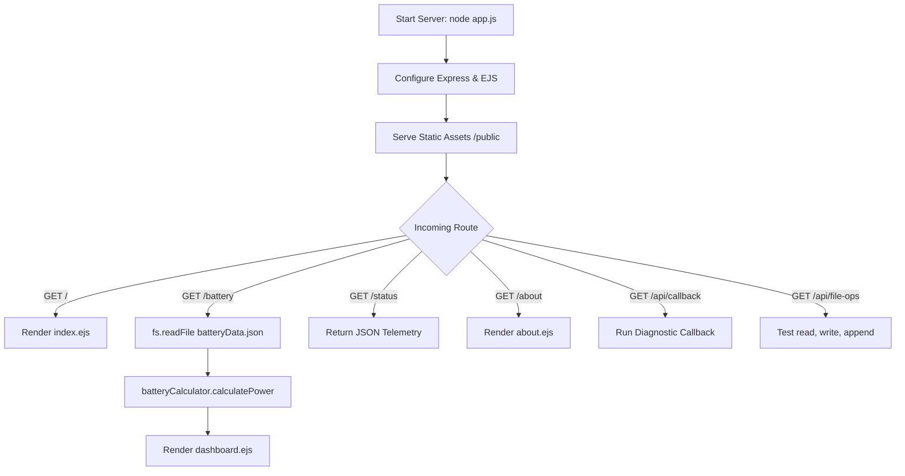

# ⚡ LAB MANUAL: EXPERIMENT 6
## Battery Management System (BMS) with Node.js & Express.js

---

### 1. AIM
To build a Battery Management System (BMS) web application using Node.js, Express.js, EJS template engine, and the File System (`fs`) module.

---

### 2. OBJECTIVES
- Create an HTTP server using the built-in `http` module.
- Build RESTful routes (`/`, `/battery`, `/status`, `/about`) in Express.js.
- Demonstrate asynchronous error-first callbacks for battery health diagnostics.
- Perform file operations: `readFileSync()`, `readFile()`, `writeFile()`, and `appendFile()`.
- Create and export a custom module (`batteryCalculator.js`).
- Render dynamic views using EJS and serve static files with custom CSS.

---

### 3. PROBLEM STATEMENT
Battery packs in electric vehicles and energy storage systems require continuous monitoring of voltage, current, temperature, State of Charge (SoC), and State of Health (SoH). This project implements a web server to store, calculate, log, and display battery telemetry in real-time.

---

### 4. APPARATUS / SOFTWARE USED
- **Node.js** (v16+)
- **Express.js** (v4.x)
- **EJS Template Engine** (v3.x)
- **Built-in Modules**: `http`, `fs`, `path`
- **Web Browser** & Text Editor (VS Code)

---

### 5. THEORY

1. **Node.js Architecture**: Built on Chrome's V8 engine; uses a single-threaded, non-blocking, event-driven architecture powered by `libuv`.
2. **HTTP vs Express**: Native `http.createServer()` is low-level; Express simplifies routing, middleware, and template rendering.
3. **Callbacks**: Error-first pattern `callback(err, data)` handles asynchronous tasks without blocking the server.
4. **File System (`fs`)**:
   - `fs.readFileSync()`: Synchronous (blocking) file read.
   - `fs.readFile()`: Asynchronous (non-blocking) file read.
   - `fs.writeFile()`: Overwrites or creates a file asynchronously.
   - `fs.appendFile()`: Appends data to an existing file without overwriting.
5. **CommonJS**: Uses `module.exports` to export functions and `require()` to import them.
6. **EJS**: Embeds JavaScript into HTML using `<%= %>` (escaped output), `<%- %>` (raw output), and `<% %>` (script logic).

---

### 6. ALGORITHM
1. **Start Server**: Load Express, configure EJS as view engine, and mount `public/` for static assets.
2. **Define Routes**:
   - `GET /`: Read battery data and render Home Page (`index.ejs`).
   - `GET /battery`: Read `batteryData.json`, calculate power & capacity, and render Dashboard (`dashboard.ejs`).
   - `GET /status`: Return battery metrics in JSON format.
   - `GET /about`: Render About Page (`about.ejs`).
3. **File Operations**:
   - Read `batteryData.json` synchronously on startup.
   - Read asynchronously on user requests.
   - Write updated values to `batteryData.json`.
   - Append log events to `logs.txt`.
4. **Calculations**:
   - $\text{Power } (W) = \text{Voltage } (V) \times \text{Current } (A)$
   - $\text{Remaining Capacity } (Ah) = \text{Capacity } \times (\text{SoC} / 100)$
   - $\text{Efficiency } (\%) = (\text{P}_{out} / \text{P}_{in}) \times 100$
5. **Callback Flow**: Check battery $\rightarrow$ Read data $\rightarrow$ Execute callback $\rightarrow$ Print health status.

---

### 7. FLOWCHART



---

### 8. STEP-BY-STEP PROCEDURE
1. Initialize the project: `npm init -y`.
2. Install dependencies: `npm install express ejs`.
3. Create native server `server-http.js` on port 3001.
4. Create custom calculation module `modules/batteryCalculator.js`.
5. Create file manager `modules/fileManager.js` with `fs` operations and callback flow.
6. Create `data/batteryData.json` with sample 16S battery metrics.
7. Create Express routes in `routes/batteryRoutes.js` and server core in `app.js`.
8. Create EJS views (`index.ejs`, `dashboard.ejs`, `about.ejs`) and CSS (`style.css`).
9. Run and verify:
   - `npm start` (Dashboard on port 3000)
   - `npm run start:http` (Native server on port 3001)

---

### 9. CODE EXPLANATION (KEY SNIPPETS)

#### A. Custom Module (`modules/batteryCalculator.js`)
```javascript
function calculatePower(v, i) { return +(v * i).toFixed(2); }
function calculateRemainingCapacity(cap, soc) { return +(cap * (soc / 100)).toFixed(2); }
function calculateEfficiency(pIn, pOut) { return pIn > 0 ? +((pOut / pIn) * 100).toFixed(2) : 0; }
module.exports = { calculatePower, calculateRemainingCapacity, calculateEfficiency };
```

#### B. Callback Pattern & File System (`modules/fileManager.js`)
```javascript
// Asynchronous read with callback
fs.readFile('data/batteryData.json', 'utf-8', (err, data) => {
  if (err) return callback(err);
  callback(null, JSON.parse(data));
});

// Callback demonstration
function checkBatteryHealthWithCallback(cb) {
  console.log('Checking Battery...');
  setTimeout(() => {
    console.log('Battery Data Loaded...');
    console.log('Callback Executed');
    console.log('Battery Health: Good');
    cb(null, { status: 'Good' });
  }, 300);
}
```

#### C. JSON Status Route (`routes/batteryRoutes.js`)
```javascript
router.get('/status', (req, res) => {
  res.json({
    batteryId: data.batteryId,
    voltage: data.voltage,
    current: data.current,
    temperature: data.temperature,
    chargePercentage: data.chargePercentage,
    batteryHealth: data.batteryHealth
  });
});
```

---

### 10. EXPECTED OUTPUTS

#### Terminal Console (`npm start`)
```
⚡ BATTERY MANAGEMENT SYSTEM (BMS) - LAB EXPERIMENT 6
🚀 Server listening on: http://localhost:3000
Power (51.84V * 14.50A): 751.68 W
Checking Battery...
Battery Data Loaded...
Callback Executed
Battery Health: Good
```

#### JSON Response (`GET /status`)
```json
{
  "batteryId": "BMS-EV-7048",
  "voltage": 51.84,
  "current": 14.5,
  "temperature": 29.4,
  "chargePercentage": 84,
  "batteryHealth": "Good"
}
```

---

### 11. VIVA QUESTIONS & ANSWERS (TOP 20)

**Q1. What is Node.js?**  
*Ans:* A cross-platform JavaScript runtime environment built on Chrome's V8 engine for server-side development.

**Q2. What is the Event Loop?**  
*Ans:* The mechanism that allows Node.js to perform non-blocking asynchronous I/O operations on a single thread.

**Q3. Difference between synchronous and asynchronous operations?**  
*Ans:* Synchronous blocks the execution thread until finished; asynchronous delegates the task and notifies via callbacks or promises without blocking.

**Q4. Difference between `fs.readFileSync()` and `fs.readFile()`?**  
*Ans:* `readFileSync()` is blocking (halts the server); `readFile()` is non-blocking and uses a callback function.

**Q5. What is an error-first callback?**  
*Ans:* A convention where the first argument of the callback is reserved for an error object (`err`), and subsequent parameters contain data.

**Q6. What is Express.js?**  
*Ans:* A minimal and flexible Node.js web application framework providing routing, middleware, and view rendering.

**Q7. What is middleware in Express?**  
*Ans:* Functions that have access to the `req`, `res`, and `next` objects to inspect or modify incoming requests.

**Q8. What does `express.static()` do?**  
*Ans:* Built-in middleware used to serve static files like CSS, images, and client JavaScript from a folder.

**Q9. What is EJS?**  
*Ans:* Embedded JavaScript; a server-side templating engine that compiles dynamic HTML using vanilla JS tags.

**Q10. Explain EJS tags `<%= %>`, `<%- %>`, and `<% %>`.**  
*Ans:* `<%= %>` outputs HTML-escaped text; `<%- %>` outputs raw unescaped HTML; `<% %>` runs script logic (loops, conditions) without outputting.

**Q11. Difference between `fs.writeFile()` and `fs.appendFile()`?**  
*Ans:* `writeFile()` overwrites existing file content; `appendFile()` adds content to the end of the file.

**Q12. What is CommonJS?**  
*Ans:* The default module standard in Node.js using `module.exports` to export and `require()` to import.

**Q13. What is State of Charge (SoC)?**  
*Ans:* The remaining battery capacity expressed as a percentage of its total capacity (0% to 100%).

**Q14. What is State of Health (SoH)?**  
*Ans:* A metric reflecting the overall condition and degradation level of a battery pack compared to its fresh state.

**Q15. How is battery power calculated?**  
*Ans:* $P = V \times I$ (Power in Watts = Voltage in Volts $\times$ Current in Amperes).

**Q16. How is remaining capacity calculated?**  
*Ans:* $\text{Capacity (Ah)} \times (\text{SoC} / 100)$.

**Q17. What is the purpose of `package.json`?**  
*Ans:* Manifest file containing project metadata, start scripts, and package dependency declarations.

**Q18. How do you return JSON instead of HTML in Express?**  
*Ans:* Use `res.json(dataObject)` instead of `res.render()`.

**Q19. How do you handle 404 errors in Express?**  
*Ans:* Place a catch-all middleware `app.use((req, res) => res.status(404).render('404'))` at the end of all routes.

**Q20. Why do we need `JSON.parse()` after reading a file?**  
*Ans:* `fs.readFile()` returns a raw string or Buffer; `JSON.parse()` converts it into an accessible JavaScript object.

---

### 12. CONCLUSION
The Battery Management System (BMS) application was successfully implemented using Node.js, Express.js, EJS, and the `fs` module. Low-level HTTP servers, Express routing, synchronous/asynchronous file operations, callback patterns, and custom modules were demonstrated and verified.
